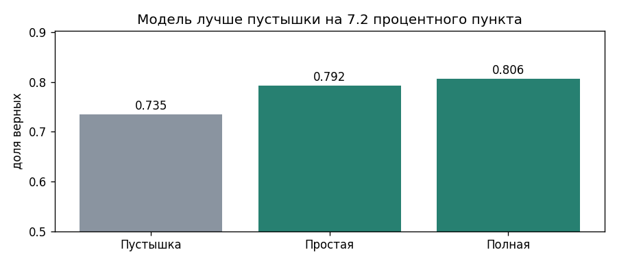

# Прогнозирование оттока клиентов Telco

## Задача

Прогнозирование ухода клиентов телеком-компании.

- Тип задачи: бинарная классификация
- Целевой признак: Churn
- 0 — клиент остался
- 1 — клиент ушёл
- Основная метрика: Accuracy

## Данные

Источник:
https://raw.githubusercontent.com/IBM/telco-customer-churn-on-icp4d/master/data/Telco-Customer-Churn.csv

Одна строка описывает одного клиента.

- Исходных строк: 7043
- Исходных столбцов: 21
- Очищенных строк: 7043
- Очищенных столбцов: 22
- Доля оттока: 26.54%

## Что сделано с данными

| Шаг | Решение | Строк |
|---|---|---:|
| Дубли | Удаляем только полные дубли строк, если они есть | 7043 |
| Невозможные значения | Нарушений проверенных правил нет. Строки сохранены. | 7043 |
| Пропуски | 11 пустых TotalCharges: флаг пропуска и заполнение нулём для новых клиентов | 7043 |
| Типы данных | TotalCharges преобразован из текста в число. Категории оставлены текстовыми. | 7043 |
| Даты | Даты отсутствуют, преобразование не требуется. | 7043 |
| Выбросы | Проверены tenure, MonthlyCharges и TotalCharges методом IQR. Крайние значения сохраняем, логарифм рассмотрен для TotalCharges. | 7043 |

## Главное из EDA

- Клиенты с помесячным договором: отток 42,7%.
- Клиенты с двухлетним договором: 2,8%.
- Клиенты с Fiber optic: 41,9%.
- Клиенты с Electronic check: 45,3%.
- Среди клиентов со стажем до 12 месяцев: 47,4%.

## Новые признаки

Созданы три дополнительных признака:

- n_addons — количество дополнительных услуг.
- is_new_customer — стаж до 12 месяцев.
- has_autopay — наличие автоматической оплаты.

Подготовка реализована через Pipeline:
числовые признаки обрабатываются SimpleImputer
и StandardScaler, категории — OneHotEncoder.

Кодирование редких категорий настроено через
min_frequency=10. На train категорий с частотой
менее 10 не обнаружено.

## Проверка утечки

Churn исключён как целевая переменная.
customerID исключён как технический идентификатор.

Дополнительно проверен TotalCharges.
Accuracy с этим признаком: 80.69%.
Accuracy без него: 80.64%.

Поскольку дата расчёта TotalCharges неизвестна,
из итоговой модели исключены TotalCharges
и TotalCharges_missing.

## Результаты

Кросс-валидация на train:

| Модель | Accuracy |
|---|---:|
| Пустышка | 73.46% |
| Простая | 79.23% |
| Полная | 80.64% |

Отложенная тестовая выборка:

- Пустышка: 73.46%
- Полная модель: 79.84%
- Улучшение: +6.39 процентного пункта

График сравнения:

## Выводы

Модель превосходит baseline на тестовой выборке.
Стаж, договор и способы оплаты связаны с оттоком.

Pipeline позволяет выполнять подготовку
внутри кросс-валидации без обучения
преобразований на тестовых данных.

Для дальнейшего улучшения необходимо изучить
recall, precision, F1-score и проверить
качество на новых данных.

## Как запустить

1. Установить библиотеки:

    pip install -r requirements.txt

2. Открыть project.ipynb.

3. Выполнить все ячейки сверху вниз.

Источник данных загружается автоматически.
